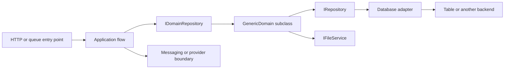

# Rich domains and data access

This guide records the design used by Niobium.Store, Niobium.Notification and
Niobium.Invoicing, investigated for Notification PR #2. Business operations belong
in rich domain objects. A mutable entity or contract is a persistence/transport
snapshot; it is not expected to contain the entire domain implementation itself.

## Responsibilities

| Layer | Owns | Avoid |
| --- | --- | --- |
| Contracts/entities | Stable wire/storage shapes, key metadata and scalar values | Transport credentials, backend clients or workflows |
| Domain (`GenericDomain<TEntity>`) | Invariants, meaningful state transitions, mutation intent and persistence | Public setters as the only business API; moving all decisions into a flow |
| Flow (`IFlow`) | Coordinating domains, rendering, messaging and external calls in the required order | Reimplementing domain transitions or database adapters |
| Domain repository | Constructing/initializing domain objects and managing its local caches | Treating a returned domain as proof that a stored row exists |
| `IRepository<TEntity>` | Backend-independent retrieval and conditional persistence operations | Assuming all implementations offer transactions or identical failure shapes |
| Database adapter | SDK mapping, backend operations and client factories | Application-specific business rules |

`IAzureTableClientFactory` is an adapter-level dependency. Application business
code should normally consume a domain or `IRepository<TEntity>`, not construct
Table entities, submit SDK operations or implement its own entity mapper. If an
operation is missing, first examine the repository API and adapter; extend shared
framework support when the capability is absent.

## Initialization and registration

The [registration helper](../Niobium.Abstractions/IServiceCollectionExtensions.cs)
finds `IFlow`, `IDomain<TEntity>` and domain-event handlers in the supplied assembly.
`RegisterDomainComponents(typeof(Core.DependencyModule))` registers flows and domains
as transient, plus `IDomainRepository<TDomain,TEntity>` and its domain factory.
The host separately registers an `IRepository<>` backend using the appropriate
platform module. `Lazy<IRepository<TEntity>>` defers resolving that backend.

From a flow, call `IDomainRepository.GetAsync(partition, row)` and then a meaningful
domain method. Key-based `GetAsync` constructs an initialized domain; the first
`TryGetEntityAsync` or `GetEntityAsync` loads the entity. The former permits a missing
entity, while the latter raises the domain NotFound error. `Initialize(entity)` is
for a known snapshot/new entity; it does not verify storage. Initialize is one-shot,
so obtain a new domain rather than expecting a second Initialize to replace state.

`BuildAsync` creates an initialized domain and affects repository caches. It does
not save a row. Do not share cached domain instances as a distributed lock or make
a claim repository singleton. `forceLoad` invalidates the instance cache, but the
current implementation can still return a domain from a cached partition; use
explicit `ReloadAsync` when a fresh backend read is required.

## Mapping and persistence

[EntityMappingHelper](../Niobium.Abstractions/EntityMappingHelper.cs) uses public
properties and `[EntityKey]` annotations for PartitionKey, RowKey, ETag and Timestamp.
ETag properties must be strings. Timestamp properties use DateTimeOffset or its
nullable form. Reverse-time key conversion is deliberate; do not replace it with
ordinary Unix milliseconds. JSON attributes do not define the Table mapping.
Avoid adding public computed properties to stored models without checking the mapper.

Use enums in domain decisions and for finite outcomes. The current Table mapper
passes ordinary property values directly to the Azure SDK and does not provide a
general enum codec. Store uses integer status columns with explicit enum conversions;
Notification's submission domain follows that approach. Give numeric values explicit
assignments, reject unknown values and version storage changes. Do not silently
replace deployed string or integer values merely to improve C# types.

[GenericDomain.SaveAsync](../Niobium.Abstractions/GenericDomain.cs) has three materially
different paths:

| Call / entity | Actual repository operation |
| --- | --- |
| Default save without a mapped, non-null ETag | Conditional `CreateAsync`, replacement disabled |
| Default save with a mapped, non-null ETag | `UpdateAsync`, precondition checking enabled, replacement rather than merge |
| `SaveAsync(force: true)` | `CreateAsync(replaceIfExist: true)`, an upsert path without an ETag update precondition |

An empty/wildcard ETag is not safe evidence for a conditional business transition.
Validate it before a claim. Do not use `force: true` to solve conflicts or implement
idempotency. Copy the stored snapshot before a mutation whose write may fail, then
persist through the domain; an in-memory mutation is not a committed transition.

The base save refreshes its entity cache from repository results and invokes domain
event handlers **after** persistence. These callbacks are not a transactional
outbox. A callback can fail after the write committed. Separate records, partitions,
Blob writes and queue/provider operations are not made atomic by belonging to a domain.
The Table adapter batches within partitions and chunks operations; the entire input
sequence is not one cross-partition transaction. Provision tables in application
infrastructure; `IRepository` does not create a missing table on first use.

## Verified limitations and framework improvements

Inspection used framework baseline `5c527723a607c1d03c002d4aa70531c9a55a767e`.
The relevant abstraction files match consumed Abstractions 4.0.61 at
`c2462746614ee6c768d725c99e3c54df2e3848c8`; the relevant Table files match 4.0.60 at
`1fa044968f504ef575021720c728a17dc72bb067`. This is not a claim about every framework
module or every consumer host's package graph.

- **Write ETags:** `CloudTableRepository` captures response ETags on its internal
  entity. `DBEntityHelper.FromTableEntity` converts dictionary entries to the model
  but loses that separate metadata on writes. Reads retain ETags. Notification's
  real-adapter test reproduces this with the installed package. Until corrected,
  a domain that needs the new version must read back and verify its own complete
  mutation, including a unique write identity for claims, before using that ETag.
  Blindly borrowing the latest row's ETag could authorize a different writer's work.
  Fixing this centrally should preserve ETag metadata in model conversion and test
  single writes, batches, stale updates and read/write round trips. No application
  SDK adapter is required to implement conditional create/update.
- **Cached hashes:** `GenericDomain.GetHashAsync` caches an ETag separately from the
  entity. Save/Reload do not reset that field in the inspected implementation. Use
  the verified entity version for concurrency; a central cache-invalidation fix
  should cover save and reload, including a cached partition-domain instance.
- **Failures:** read paths can wrap SDK errors in HttpRequestException, while write
  paths can propagate SDK failures; multi-operation failures can aggregate. Do not
  translate an unknown timeout into a definitive failed write or retry with an
  unconditional upsert. Verify the installed adapter before handling a conflict.

These are observed framework follow-ups, not changes delivered by this documentation.
No framework runtime code or consumer package versions were changed for this guide.

## Examples and review rules

- Store: `ShippingOptionDomain.QuoteAsync` owns supported-country and price behavior;
  `OrderDomain` owns order transitions and notification creation. Existing force-save
  calls illustrate API use, not proof of concurrency or payment deduplication.
- Notification: `TemplateDomain`, `SubscriptionDomain` and the submission domain in
  [PR #2](https://github.com/niobium-nz/Niobium.Notification/pull/2). Its flow schedules
  recovery before the provider call; the domain owns the durable claim and outcome.
- Invoicing: `InvoiceDomain`, `InvoicePreparation` and `InvoiceItemDomain` keep invoice
  invariants inside the domain, including conditional preparation/freeze/read-back.

Keep I/O, persistence and other state-changing actions out of `if` conditions.
Await/execute the action, name its result, then test that result. Pure predicates
and lookup checks may remain in conditions. Prefer one existing options class for
related application settings; provider-specific configuration stays at its boundary.

Before changing behavior, verify the consumer's actual package references and
matching framework source. Exercise domain decisions with repository fakes, then
use real adapter tests for ETags, mapping, missing data and partial-write behavior.
A framework source change does not alter an already published package. Plan package
release and consumer rollout explicitly; do not silently substitute ProjectReferences.
